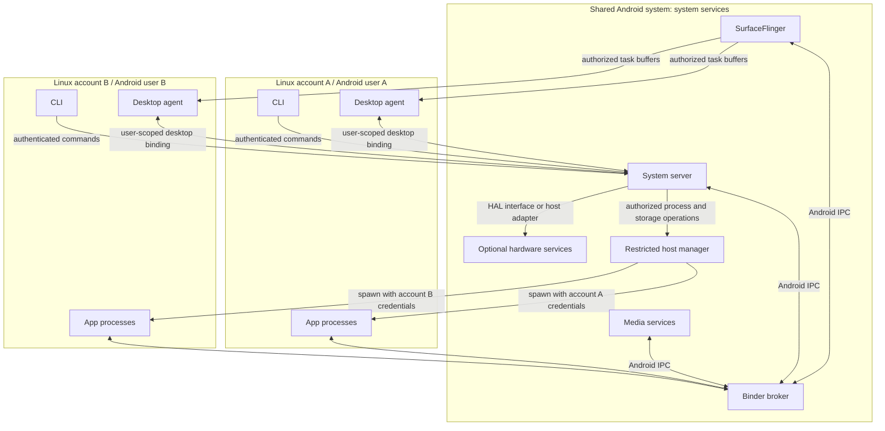

# Shared Android system and standalone mode

Status: migration in progress. The executable split is implemented; shared
machine services and multi-user operation are not implemented yet.
[Architecture](architecture.md) describes the current implementation;
[packaging](packaging.md) describes the current installation.

The first increment adds private system/app/metadata/JVM-test entry points, a
standalone supervisor outside ART, and an ART desktop controller. The public
command dispatches without ART; existing internal flags remain compatible.
Image, storage and bootstrap code now have explicit modules, and session startup
passes system/app executable paths. `--system` rejects unsupported deployment
rather than silently using standalone state. Executable separation does not
establish multi-user safety.

Phase 2 has started: stock `PermissionPolicyService` replaced
`HostedWindowPermissionPolicy`, stock `DeviceStorageMonitorService` runs, and
stock `StorageManagerService` replaced `HostedStorageManagerService` over the
`HostedVold` and `HostedStoraged` daemon stand-ins and a MediaProvider stand-in
that hosts the stock `ExternalStorageService` binding. Two host facts surfaced
below that Java and are now part of the session: the media service starts
beside the system process (the stock storage service enumerates codecs through
`media.player` at its systemReady), and every session process runs in a
session-wide user and mount namespace that supplies `/storage/emulated/0`
(`src/binder/StorageView.zig`), because the stock service validates and
canonicalizes app directories as `/storage/<volume>/<user>/Android/...`.
The session also seeds `ro.vendor.api_level` before any process starts; the
media service used to set it at runtime, so services that read it during boot
(telephony feature gating) saw a different device than later clients; it seeds
the codec HAL selection the same way. Stock `InputManagerService` replaced the
hosted input services over a host event hub that presents the Wayland seat as
evdev devices to stock InputReader (see
[Input manager replacement](#input-manager-replacement)); the session's mount
view now also binds the data partition at `/data`. Remaining in phase 2:
`LockSettingsService`, `DisplayManagerService`, and `ActivityManagerService`
with `UserController`.

A prototype answered the single-account half of the two-user feasibility gate;
see [Two-user prototype findings](#two-user-prototype-findings). It was built on
the hosted services and is not on `main`. The AOSP code policy in `AGENTS.md`
requires stock services instead, so the implementation sequence now replaces
the hosted services the multi-user path depends on before repeating the gate.

## Target

Support two deployment modes using the same Android framework, service binaries
and component protocols:

- **System mode:** one machine-wide Android system, managed by systemd system
  services under dedicated service accounts. Linux accounts connect as distinct
  Android full users. Desktop integration runs inside each Linux user's login.
- **Standalone mode:** one private Android system owned by the invoking Linux
  user, without root, system service installation or a running systemd instance.
  Preserve local APK launch, explicit session joining and the existing headless
  test harness. An optional user service can keep this private system running.

System mode is not a collection of independent per-user Android systems. The
broker, system server, SurfaceFlinger and media services are shared across the
machine. Standalone mode is a supported deployment, not an emulation or a
temporary compatibility path.

The process design leaves room for privileged process setup and hardware
services. The per-app sandbox direction is decided in
[App sandbox](#app-sandbox); its implementation follows the launch-contract phase.
System mode nevertheless must keep app code out of service accounts and must
enforce boundaries between Linux users before it is enabled for general use.

The shared-system choice has two deliberate costs: a package-code update can
affect every user of that package, and a core-service failure can interrupt all
connected users. User data and grants remain separate, but neither independent
package versions nor independent core-service availability is promised. Validate
concurrent desktop use in an early prototype before expanding the migration.

## Baseline constraints identified before migration

| Code | Constraint to remove or preserve |
| --- | --- |
| `src/main.zig` | Public CLI, ART bootstrap, system/app/test entry points, storage and session ownership share an executable |
| `src/binder/session.zig` | Launcher supervises the whole graph, distributes cookies and supplies one storage environment |
| `src/binder/Broker.zig` | Admission rejects Linux peers whose UID differs from the broker's UID; service identity also depends on a shared system cookie |
| `src/binder/LaunchGrants.zig` | Existing one-use grants and process binding already carry Android UID/user information; retain this foundation |
| `src/binder/ProcessNamespace.zig` | Each app's namespace currently maps its Android UID to the launching host UID; this is not a full app sandbox |
| `HostedUserLifecycle.kt` | Stock `UserManagerService` owns the user catalogue; this stand-in for `UserController` starts only Android user 0 |
| `HostedActivityManagerService.kt` | Process, provider, service and broadcast paths resolve packages for user 0; stock PackageManagerService registers only user 0's UIDs with the broker |
| `HostedZygoteService.kt` | App children inherit the system process's host credentials and re-execute the launcher |
| `SessionTaskShell.kt` | One global presenter is required during bootstrap; presenter death exits the system process |
| `HostedSessionDisplayService.kt` | Several display paths assume the default display and system user |
| `src/native/audio/` | System-process audio adapters currently connect to PipeWire; a machine service cannot simply inherit one desktop user's audio environment |

## Process boundaries

Names below are proposed executable/unit names, not commands currently shipped.

| Component | Responsibility | System-mode host identity |
| --- | --- | --- |
| `androlinzberg` | Public install, launch and status client; selects the endpoint | Invoking Linux user |
| `azk-binder-broker` | Binder transport, authenticated identities, service registry, properties, bounded resource accounting | Dedicated `azk-broker` account |
| `azk-system-server` | Android services, package/user authority, AMS/ATMS/WMS, host command and desktop registration adapters | Dedicated `azk-system` account |
| `azk-surfaceflinger` | Android composition and task outputs | Dedicated `azk-graphics` account with required render-device access |
| `azk-media-service` | Existing media resource services; additional native services only where their Android boundary justifies it | Dedicated `azk-media` account |
| `azk-host-manager` | Restricted cross-UID process launch, approved storage-worker startup, child handles and cleanup | Privileged setup service, with minimum required privileges |
| `azk-app-process` | Authorization gate, ART bootstrap and Android application entry | Owning Linux user's credentials initially; future sandbox credentials behind the same launch boundary |
| `azk-desktop-agent` | Existing task presenter plus user-scoped desktop integration; may use worker processes as needed | Logged-in Linux user |
| `azk-standalone` | Foreground supervision of a private instance using the same service entry points | Invoking Linux user |

Keep ART/JNI bootstrap in a shared internal module used by system/app/metadata/
test executables. The public client does not embed ART or become an Android
system-UID peer. Metadata parsing remains in an ART-capable component using the
existing AOSP parser. Private test executables replace production test flags.

The host manager is not an Android policy engine. AMS/hosted zygote determines
the Android process request; the manager applies a validated launch grant,
fixed runtime executable, host credentials, storage and inherited descriptors.
It must not accept arbitrary executables, environment variables, filesystem
paths or a caller-selected root identity. ART and APK constructors execute only
after privileges have been dropped and the child has been bound to its grant.
The manager owns child handles; Android owns process lifecycle decisions.

In standalone mode these operations use an in-process unprivileged host adapter.
That adapter can launch only as the current host user and within its private
storage root. A production adapter and in-memory test adapter exercise the same
launch/setup contract. Do not add deployment-mode branches to Android callers.

### Privileged operation contract

The initial host-manager API is limited to the operations below. Only the
authenticated system-server service role may submit mutations; the broker
validates launch grants through its separate service identity. Desktop clients
cannot call this API directly. Each request is bound to the current instance
generation and a unique operation ID; retry/query returns the same result
rather than launching another process.

| Operation | Inputs and authority | Result |
| --- | --- | --- |
| Start app | One-use broker grant; enrolled host-account identity; package generation; validated Android specialization data; typed descriptor slots | Opaque child handle, bound process identity and eventual exit result |
| Cancel/stop app | Child handle and generation owned by the requesting authority | Idempotent stop result after bounded termination/reaping |
| Start storage worker | Enrolled account and registered storage-root identity; fixed worker role | Worker running under that account's credentials with a private operation channel |
| Retire generation | Current generation from its service authority, or authority-channel loss | All owned children stopped and handles invalidated |

The administrator-owned enrollment record constrains target host credentials;
Android user/package policy remains in system server. Cross-check both before
launch. Clients cannot request UID 0, a service account, an unregistered Linux
account, extra groups or capabilities. Use only image-selected executables and
library paths. Construct a minimal environment; explicitly set supplementary
groups, UID/GID and capability state before the release gate permits ART.

Descriptor slots have fixed meanings (setup pipe, verified APK, registered
storage, diagnostics) and require type, ownership, access-mode and generation
validation. Close all other inherited descriptors. Hold stable process handles
for authorization/termination so PID reuse cannot redirect an operation.

Do not perform recursive writes, deletes, mounts or ownership changes as root
through user-provided paths. Root performs credential setup only for personal
storage workers; workers drop privileges before opening personal paths. Root
directories are registered under the account's identity and operations resolve
relative to retained directory handles, with traversal/symlink escape rejected.
Shared machine directories are provisioned by installation with explicit owners.
Any later privileged mount operation needs its own reviewed contract; it is not
implicitly authorized by a generic storage or launch request.

Trusted services must copy/verify user-supplied bytes before committing shared
package code, and must not load executable cache artifacts from a user-writable
location. A descriptor is a reference to an object, not proof that its content
is trusted or immutable. Test descriptor substitution, path races, replay and
authority loss before expanding this API.

The diagram shows logical interfaces, not a new replacement for Binder. Keep
existing Android AIDL/native interfaces between framework components. Host-only
commands need a small versioned protocol with bounded requests, explicit errors
and completion semantics. Put command adaptation inside the system server; do
not introduce a separate daemon just to forward individual Android calls.

## Two deployment contracts

| Property | System mode | Standalone mode |
| --- | --- | --- |
| Service owner | systemd system manager, separate units/accounts | Foreground supervisor; optional systemd user wrapper |
| Android users | Headless system user 0 plus persistent full users mapped to Linux accounts | Existing full system user 0 for the invoking account |
| Shared state/code | `/var/lib/androlinzberg/`: account mappings, package authority and committed shared APKs | Private instance metadata within the existing data root |
| Personal data | Per-account XDG data directory, in a system-instance-specific subtree | Existing `$XDG_DATA_HOME/artzig` default and explicit overrides |
| Cache | Shared service artifacts in `/var/cache/androlinzberg/`; personal caches in each account's XDG cache directory | Existing XDG cache layout |
| Runtime endpoints | `/run/androlinzberg/` | Private instance directory under `$XDG_RUNTIME_DIR` or explicit harness root |
| Configuration | Administrator-owned `/etc/androlinzberg/` | User configuration/explicit arguments |
| Desktop | Agents attach and detach independently of boot | Same agent registration, one user |
| Privileges | Narrow host manager and separately configured hardware services | No elevation; unavailable privileged operations return explicit capability errors |
| Lifetime | Independent of any login or CLI | Preserve launch-owned lifetime by default; explicit persistent session optional |

Provide explicit `--system` and `--standalone` selection. Installation config
chooses the default; the development tree defaults to standalone. Never silently
fall back to a private system when a configured machine system is unavailable:
that would make installed packages and data appear to disappear. Existing APK
and `--join` workflows remain available during migration; endpoint identity
includes deployment mode and generation.

Both modes can run concurrently with separate sockets, credentials, properties,
storage, locks and diagnostics. One canonical data root has exactly one owner.
Standalone must not read or write machine state merely because both use the
same binaries. Migration of existing standalone data is an explicit stopped-
instance import with ownership/user-ID translation and rollback, never an
in-place automatic adoption.

### Storage ownership and availability

Use `$XDG_DATA_HOME/androlinzberg/system/<instance-id>/` and the corresponding XDG
cache subtree for personal system-mode storage; keep existing standalone roots
unchanged. Apply the normal home-relative XDG defaults. The stable instance ID
survives restarts and differs from the ephemeral process generation. Resolve
these roots in the authenticated user's context, not from the system service's
environment. Register them through the account's storage worker; personal
configuration cannot redirect privileged writes or another user's storage.

Personal app files, external storage and user settings belong to the Linux
account. Security-authoritative enrollment, package IDs and permission grants
remain in protected machine metadata even when keyed by Android user. The
package manager owns that metadata; a user-owned file cannot grant Android
permissions. This distinguishes personal content from authoritative service
state rather than putting all per-user records into a writable home directory.

System services access personal content through bounded storage operations or
explicitly authorized file descriptors, without blanket access to home trees.
Path-based native/framework consumers need a scoped per-process storage view
supplied at the host boundary; specify and test that view before enabling them
in shared mode. Preserve Android-visible CE/DE/external path semantics without
scattering host path checks through framework callers.

Storage availability is a prerequisite for starting an Android user. If the
home is absent, encrypted or unmounted, leave that user unavailable and return
an explicit storage error; never create a replacement empty tree under `/var`.
Machine services and other users continue running. For planned logout/unmount,
stop affected apps and storage workers, flush writes and close held descriptors
before releasing the storage binding. Unexpected I/O loss fails the affected
user's operations and stops its work without redirecting writes. A screen lock
alone does not change storage availability. Background-after-logout policy is
valid only while the storage binding remains available.

## Identity, users and state

Keep three identities distinct: Linux peer credentials, Android user ID, and
Android app UID. Use pinned `UserHandle.getUid(userId, appId)` and the matching
helpers; do not equate a Linux UID with an Android user ID or use an app ID as
a full UID. Reserve Android user 0 for machine services in system mode.

The system-server user authority persists Linux-account-to-Android-user mapping.
The broker consumes authorized mappings/grants instead of independently
allocating a second user catalogue. Account removal/reassignment requires
explicit deprovisioning: numeric Linux UID reuse must not silently grant access
to a previous person's Android data. Renaming a login does not itself change
Android identity. Initial enrollment is administrator-authorized; support
self-enrollment later only as an explicit host policy.

Authenticate control connections using kernel peer credentials. Desktop agents
receive rights for their account, desktop session and attachment generation;
they never receive a machine-wide system cookie or permission to impersonate
arbitrary packages/users. A caller-supplied user ID is not authorization.
Cross-user operations require the corresponding Android permission and host
administrative authorization where applicable.

Replace same-host-UID-only broker admission with explicit service identities,
authorized desktop peers and one-use app grants bound to a real child handle,
Android UID, instance generation and expected host credentials. Preserve
namespace identity checks and the pre-ART release gate. Do not merely remove
the current UID check or distribute the current system cookie to every account.
Authorize service registration per role/name rather than giving every service
full system-server authority. Keep inspector admission test-only and explicitly
scoped; a desktop agent is not Android's shell inspector.

Use shared package code/metadata and per-user installation, grants, enabled/
stopped state and data, following AOSP. A package version update is consequently
a shared-code operation that can affect several users; require machine update
policy instead of letting one ordinary user replace everyone else's code.
Same-version enablement and per-user uninstall must not mutate another user's
installation. Independently installed versions of the same package per account
are outside the initial shared-system model; standalone remains available.

Persist package app IDs before process admission. Establish per-user CE/DE,
external storage and cache roots; retain the distinction between Android data
and ART's `ANDROID_DATA` cache. Use controlled staging/copying for APK input,
not service access to arbitrary home directories. The package manager decides
the transaction; the host storage adapter applies its filesystem operations.
Initial app data belongs to its host account, not the system-server account;
service-private metadata stays inaccessible to apps. Per-app isolation within
one account follows [App sandbox](#app-sandbox) and must not be advertised as
solved before that work lands.

Trace start, unlock, stop and removal using pinned `UserController` and
`SystemServiceManager` callbacks. Login attachment, visibility, screen locking
and Android storage unlocking are distinct events. This host currently lacks
Android FBE/vold; do not describe a desktop screen lock as cryptographic key
eviction. On desktop logout, detach presentation and stop that user's Android
work by default after its last attachment; keep machine services running.
Background execution after logout can be an explicit administrator policy.

## App sandbox

Decided direction; not implemented. It applies to both deployment modes and
sits in the pre-ART setup of `azk-app-process`, behind the same launch boundary.

The session already runs inside one user and mount namespace owned by the
host user (`src/binder/StorageView.zig`): a tmpfs root carrying recursive
binds of the host's top-level directories plus `/storage/emulated/0` over the
session's external storage root, entered by the session owner before the
broker starts and joined (`setns`) by a launcher started from a foreign
shell. Joining needs no privilege: a same-UID process in the parent namespace
holds every capability in the session's namespace. Both the owner and a joiner
drop all capabilities once inside, matching session children (which lose them
on exec): the broker authenticates trusted peers by user namespace, and it can
read a peer's namespace only when the peer holds no capability it lacks. The
view hides nothing; it is the mount layout init and vold provide, and the
per-app namespaces below nest inside it. Other users' `/storage/emulated/<n>`
binds are not supplied yet (`HostedVold` declines their emulated volumes).
Because the owner drops its capabilities once the view exists, the two-user
gate needs a component that keeps mount rights in the session namespace and
performs vold's bind at user start, below Java.

Keep the single-UID mapping of `src/binder/ProcessNamespace.zig`: each app has
its own user namespace mapping its Android UID to the owning account's host
UID. Do not allocate subordinate UID ranges (`newuidmap`, `/etc/subuid`) to give
apps distinct kernel UIDs: a 65536-ID range cannot hold Android's UID space
(100000 IDs per Android user, isolated processes from 90000). Kernel ownership
checks therefore do not separate one account's apps; the mechanisms below do.

| Exposure with one host UID | Mechanism |
| --- | --- |
| Tracing or reading another process's memory | Already refused: the per-app user namespace lacks `CAP_SYS_PTRACE` over its siblings and parent |
| Signalling the broker, system server, other apps or desktop processes | PID namespace per app |
| Seeing other processes in `/proc` | PID namespace per app, with a fresh `/proc` |
| Reading other apps' data or the account's home | Mount namespace per app: read-only image plus that app's own storage |
| Direct access to desktop sockets | Not mounted into the app's view; only typed descriptor slots are inherited |
| Undoing the sandbox from inside | `no_new_privs`, dropped capabilities and a seccomp filter before ART |

The PID and mount namespaces land together, because a private `/proc` needs
both. The first process of a PID namespace is its init: it must reap and it
ignores signals without a handler. Decide between a minimal init stub ahead of
ART and ART as PID 1 when implementing; either way the app's own PID differs
from the PID the host observes. Landlock is an optional second layer where the
kernel provides it, and cgroup limits apply only under a delegated cgroup.
Mount, seccomp and Landlock policy details are still to be specified and need
their own review; app rendering needs the render device and driver libraries
inside each app's view.

## Two-user prototype findings

A prototype ran two Android users on two desktops under one Linux account. It
is kept at the local git reference `refs/prototypes/phase2-hosted-two-users`
(not a branch; `git show refs/prototypes/phase2-hosted-two-users`). It extended
the hosted services, which the AOSP code policy does not allow, so it is
evidence and a source of tests, not code to merge. In that state the system
tests, JVM tests, all 40 UI tests and the five desktop scenarios passed.

What it established about the pinned Android version on this host:

- Stock `UserManagerService` creates further full users once `fw.max_users`
  and `fw.visible_bg_users` are set. Creation needs `DeviceStorageMonitorInternal`
  (stock `DeviceStorageMonitorService` compiles with no blockers and runs),
  `IStorageManager.createUserStorageKeys` and `LockSettingsInternal.createNewUser`.
- Stock `UserVisibilityMediator`, WindowManager and ActivityTaskManager support
  one visible full user per display here. The window manager refused a window
  of a user that was not visible on the task's display, as it does on a device.
- Launching on another display needs the system feature
  `android.software.activities_on_secondary_displays`; without it the task is
  placed on the default display.
- Stock PackageManagerService installs an existing package for a second user
  and gives it a distinct UID and data directory; the broker's launch grants
  already carry the user, so the second user's process was admitted unchanged.
- SurfaceFlinger makes windows touchable only on a layer stack that has a
  composed display, and reports a window's display as its layer stack. An
  additional Android display therefore needs a real SurfaceFlinger display whose
  layer stack equals the display ID, and that ID must not collide with the
  private per-task output stacks.
- The input dispatcher's hosted keyboard-task patch is global; two seats need
  it per display. A patch doing that applied on top of the existing series.
- A second task presenter can serve one display's tasks: the single task
  organizer routes by display, the presenter attaches itself instead of
  registering the fixed service name, and it must not make that call on its
  Wayland thread because the system calls back during attachment. Its loss was
  contained to its display.
- Two real Wayland seats delivered pointer input independently to each user's
  instance of the same app.
- The podman test container runs two Linux accounts, each with a GPU headless
  compositor and a private standalone session. It needs the host's Mesa paths,
  a CA bundle and no process-count limit; systemd user managers do not start
  in the Debian image used.

What it did not cover: two Linux accounts on one Android system, keyboard
typing, clipboard, input method, drag and drop and audio on the second desktop,
user stop and the per-user lifecycle broadcasts, and providers, services and
broadcasts of a second user. The UI runner's UiAutomation belongs to the system
user and did not see another user's windows.

Closures of the stock services that would replace the hosted ones, measured
with `tools/aosp-closure.py closure` against the live framework JAR:

| Stock service | Replaces | Sources | Blockers |
| --- | --- | --- | --- |
| `PermissionPolicyService` (done) | `HostedWindowPermissionPolicy` | 1 | 0 |
| `DeviceStorageMonitorService` (done) | nothing; absent before | 1 | 0 |
| `StorageManagerService` (done) | `HostedStorageManagerService` | 13 | 5 |
| `InputManagerService` (done) | `HostInputManagerBridge`, `HostedInputManagerService` | 40 | 5 |
| `LockSettingsService` | `HostedLockSettingsService` | 77 | 19 |
| `DisplayManagerService` | `HostedSessionDisplayService`, `HostedLogicalDisplay` | 289 | 71 |
| `ActivityManagerService` with `UserController` | `HostedActivityManagerService`, `HostedUserLifecycle` | 510 | 75 |

The blocker counts are what the tool reports before any work; most are sources
not yet in the package manifest, and the remainder are JNI natives, AIDL files
outside the include roots, absent HIDL classes and unwired generators.

## Input manager replacement

Stock `InputManagerService` replaces `HostInputManagerBridge`,
`HostedInputManagerService`, the generated `InputManagerInternal` and the
Kotlin seat translation in `WaylandTaskInput`. Its Java closure is 40 sources,
but its JNI constructs inputflinger's whole `InputManager`, so the native
closure is the larger part: InputReader and its mappers, PointerChoreographer,
InputProcessor, the interaction blockers (Chromium palm rejection over the
libchrome units it links), InputFilter (a Rust crate with Binder AIDL crates),
the ChromeOS touchpad gestures library, expresslog, libinputservice's
PointerController, and the IMS, viewport and topology JNI.

Decisions:

- The device boundary is the reader's `EventHubInterface`. Stock `EventHub`
  reads `/dev/input` with evdev ioctls, which an unprivileged session cannot
  provide, so a host event hub (`src/native/input/HostEventHub.cpp`) presents
  the Wayland seat as evdev devices (keyboard, relative mouse with wheels,
  multi-touch screen, a stylus per tablet tool) plus EventHub's
  `Virtual` keyboard, and a host `createInputReader` constructs the stock
  `InputReader` over it. Stock mappers then produce every Android event;
  nothing above the hub is host-specific. Each seat device has its own
  location or, for tablet tools sharing the tablet's port, unique id, which
  InputReader also uses to keep devices apart (`isSubDevice`). Tablet tools are
  external pen-display styluses (direct mode): a tool reports absolute positions
  on the task, and the pinned reader reports stylus buttons only in direct mode.
  The session associates the tablet's port with its display.
  Key maps load from the stock `Generic.kl`, `Generic.kcm` and `Virtual.kcm`
  the image installs under `ANDROID_ROOT/usr`, with the compositor's keymap as
  the keyboard's character map.
- The Wayland pointer is a relative mouse. The compositor has already
  accelerated it, so the session disables mouse scaling for its display through
  the stock `InputManagerInternal.setMouseScalingEnabled`, as virtual devices
  do, and the hub emits exact deltas between absolute positions. Scaling
  applies to a mouse associated with the display, so the session associates
  the pointer's input port with it (`addUniqueIdAssociationByPort`). The seat
  pins its cursor model once to the display origin (clamping makes that exact)
  and again only when the device is re-added. A gesture the seat ends early
  (resize, compositor cancel) ends by resetting that device alone: a
  `SYN_DROPPED` packet, after which the reader resets the device and the
  dispatcher cancels only its events. Hover ends when the pointer leaves for the
  desktop through the stock `cancelCurrentTouch`, issued only while no device has
  a gesture; a device reset there would make that device's next drag reach WM's
  drag window offset.
- Pointer capture keeps stock semantics: a host wrapper of the reader policy
  observes the capture request in the reader configuration and asks the
  presenter to lock the Wayland pointer and send relative motion. When the
  compositor refuses or revokes that lock, the session releases Android's
  capture through the stock `requestPointerCapture`, as the window would.
- The cursor model is clamped to the display as `MouseCursorController`
  clamps the cursor, so deltas after a grab past the edge stay exact. Wheel
  notches are high-resolution wheel axes, which the reader reads because the
  pinned BP2A release enables `high_resolution_scroll`; the flag's C++ and Java
  values come from that release configuration.
- The reader's keyboard mapper keeps lock state from lock-key edges alone. A
  Caps Lock or Num Lock state set while another client had the keyboard is
  replayed as that lock key once a session task has focus, and modifiers XKB
  latches or locks without a held key (sticky keys) are pressed around the key
  they apply to.
- The cursor shape follows stock PointerController: its sprite is a
  cursor-flagged SurfaceFlinger layer that the host composer keeps as a CURSOR
  layer, the cursor plane of a device composer. The composer advertises the
  `CursorInfo` generic metadata SpriteController publishes for a host OS (the
  ARC++ arrangement) and hands the sprite's pixels and hotspot to the presenter
  (`setDisplayCursor`), which sets the Wayland cursor. The sprite's buffers live
  on its BLAST child, so the host composition engine forwards the child's
  inherited `CursorInfo`.
- The dispatcher keeps the hosted keyboard-task and native-drag patches. A host
  `createInputDispatcher` gives host native code the instance stock
  `InputManager` owns, so those patches remain reachable without a Java bridge,
  and subscribes it to SurfaceFlinger's window infos as the stock constructor
  does on a device. The keyboard-task scoping of patch 0008 stays inert: stock
  focus already follows the compositor's keyboard focus through
  `setFocusedTask`.
- Stock code that names `/data/...` literally (`PersistentDataStore`) reaches
  the data partition because the session's mount view binds it at `/data`.

Status: done. Stock `InputManagerService` runs with its JNI, WMS patch 0039 is
reverted, and the hosted input classes, the Kotlin cursor loader and its JNI
are deleted. The Wayland tablet's wheel, slider and barrel axes have no stock
reader counterpart and are not reported, as on a device.

## Desktop, display and audio boundaries

Boot the machine system without a Wayland or PipeWire connection and without a
presenter. Retain a headless bootstrap display if stock services require it.
Registration creates an authenticated desktop binding containing Android user,
host login/session, display assignment and generation. Initially permit one
graphical attachment per Linux account; reject ambiguous second attachments
rather than silently switching outputs. Different accounts must work concurrently.

Use the pinned visible-background-user / secondary-display contracts for
concurrent users. Assign each attached desktop its own Android display or
display group as required by stock WMS/ATMS. Keep per-task outputs inside that
assignment; do not create an Android display per window. Confirm headless-system-
user and display flag requirements before committing the display representation.
Do not implement concurrency by repeatedly changing one global current user.

Replace the singleton presenter lookup with user/display-scoped registration.
The system task organizer owns Android task decisions; agents can receive only
their authorized task outputs and can inject input only into their assigned
displays/windows. Scope focus, IME, clipboard, drag, notifications, screenshots,
accessibility and desktop file transfers to the authenticated binding. Validate
ownership server-side for every task token and buffer/descriptor transfer.

Move the host PipeWire endpoint out of the shared system process into a per-user
audio adapter, associated with that same desktop binding. Keep Android
AudioTrack/AudioFlinger and policy interfaces intact. Route tracks by validated
Android UID/user, including shared control-block/PCM descriptors; never by the
last agent to connect. Define unavailable-output behavior on detach and recreate
host streams on reattachment. Linux device access stays at the relevant service
or user adapter, rather than exposing the whole desktop runtime directory.

On agent death, revoke the binding, release its inputs/transfers/buffers, and
stop or retain that user's tasks according to explicit policy. Other users stay
connected. A replacement agent receives fresh generations and rebuilt outputs;
old handles cannot regain access. This replaces today's presenter-death exit of
the whole system server.

## Supervision, readiness and failure

Install separate system units for broker, system server, SurfaceFlinger, media
and host manager, grouped by `androlinzberg.target` and a resource slice. Each
unit runs its own fixed executable under explicit credentials. systemd owns
their processes, limits, logs and cleanup; do not put another process supervisor
above systemd in system mode. The host manager owns only the app children it
launches and reports their exits to the Android process authority.

### Child ownership and cancellation

AMS/hosted zygote owns desired Android process state. The host manager is the
sole spawner and reaper of its direct children; it returns opaque handles and
terminal results to AMS, never transfers `wait` ownership. In system mode, keep
these children and their descendants inside the host-manager service cgroup
initially. systemd owns containment and kills the remaining cgroup on manager
failure/stop; the host manager owns orderly shutdown while alive. Do not move
apps into independent units until generation-wide cleanup covers those units.

Start follows `requested -> created/gated -> bound -> released -> exited`.
Validate generation, enrollment and package before spawning; bind the real child
and namespace to its one-use grant before release. A failed bind or closed gate
terminates and reaps the child. Cancelling a pending operation consumes/revokes
the grant and guarantees no later release. Stop after release targets the opaque
handle, waits a bounded grace period, then forces termination and reaps. Repeated
cancel/stop/query requests return the recorded result, with bounded result
retention and an explicit unknown/expired response after eviction.

| Failure | Required action |
| --- | --- |
| CLI disconnect | Does not cancel an already accepted launch; query by operation ID |
| AMS request cancelled during launch | Manager cancels the operation, revokes its grant and reaps any created child |
| App exits before attach or while a stop is pending | Manager reports one terminal result; AMS rejects stale attach/start-sequence events |
| System-server or broker authority lost | Manager closes release gates and stops all children of that generation; generation retirement follows |
| Host manager dies | systemd removes remaining children via cgroup cleanup; broker invalidates grants and the shared generation stops |
| Desktop agent dies | Revoke that attachment and apply its user's task policy; do not kill unrelated users |

After manager/server restart, never adopt children by PID or replay old starts.
A new generation is admitted only after previous containment is empty. Test
grandchildren and child-zygote processes as well as direct app children. The
standalone adapter preserves these semantics through its existing process
ownership mechanisms, including forced-supervisor-loss cleanup, without relying
on systemd. Kernel/process cleanup and Android callbacks are separate outcomes
and both need verification.

Do not assume that the process running ART is the manager's direct child or
that its own PID is the host-visible PID. The [app sandbox](#app-sandbox) later
places each app in a PID namespace, possibly behind an init stub. Handles,
grant binding, exit results and reaping refer to the manager's direct child and
its stable process handle; anything an app reports about its own PID is not an
identity.

Order broker and host setup before dependent services; system-server boot must
no longer wait for a user presenter. Media resource services still wait for the
system services they consume. Separate process existence, Binder registration,
Android boot completion and desktop availability in status responses. Use
`Type=notify` for system units and a dedicated readiness descriptor in standalone
mode, both driven by the same readiness transition; logs are not a protocol.

Use explicit ordering and dependency/failure relationships. `After=` orders
jobs but does not establish service readiness or propagate all failures;
`PartOf=` alone is not a restart policy. See the upstream
[unit semantics](https://github.com/systemd/systemd/blob/main/man/systemd.unit.xml)
and [service readiness](https://github.com/systemd/systemd/blob/main/man/systemd.service.xml).

Initially, broker/system-server/SurfaceFlinger/core-media loss retires the whole
Android generation and terminates its app children. Wire dependent units to
stop, including failure propagation to the target; disable independent automatic
restarts until complete generation restart is implemented and tested. An explicit
target restart recreates the graph. Losing a desktop agent affects only its
binding. Losing the host manager revokes pending starts and retires the generation
so that no unmanaged app children survive.

Shutdown first rejects new work, asks Android to stop users/apps, then stops
dependent media and framework services before graphics/broker teardown. Bound
every wait and enforce descendant cleanup on timeout. The standalone supervisor
implements the same dependency/failure contract through `std.Io` processes;
retain the existing service-exec workaround until its underlying spawn issue is
resolved. Do not make Android service code depend on systemd.

Expose generation, service state, Android user and attachment identity in
diagnostics. Keep global logs administrator-only; provide user-filtered status
and diagnostics without leaking another user's app details. Preserve structured
runtime issue reporting and the existing inspector path for tests. Add per-user
admission/resource allowances inside existing broker bounds so one user's load
cannot consume every other user's allocation.

## Installation and future privileged services

Keep one immutable artifact tree and one build identity, assembled by
`build/application.zig`. Put public commands in `bin`, private service/process
entry points in `libexec/androlinzberg`, and shared runtime payloads in a private
library/data tree. Service paths come from this installed image, never the
working directory or a caller's `PATH`. Update relocated ART/native RUNPATHs
and retain the current Nix closure requirements.

System installation provides service accounts, directory ownership, units and
administrator policy. User installation provides standalone mode and desktop
integration without system changes. Add a NixOS module for the shared system
alongside the existing scheduling module; document generic systemd deployment.
Grant priority limits and device permissions to the individual service that
needs them. Do not run the entire framework as root for future HAL support.

All services/app children in one generation use the same image. Upgrades require
coordinated stop/start of the shared graph, with a clear warning that all users
are affected; retain the old image until its children exit. Check control/Binder
protocol and data schema compatibility, reject mixed generations, and retain
rollback data before irreversible migration. A package rollback cannot undo
arbitrary database migration automatically.

Future HALs get dedicated system units/accounts and only their required device
access/capabilities. Machine resource arbitration lives there; desktop-specific
access stays in user adapters. Standalone uses a permitted host backend or
returns a structured unavailable capability. An arbitrary vendor HAL may need
unavailable drivers, transport and Android infrastructure; this design reserves
the boundary without promising compatibility or adding a generic root command
executor now.

## Implementation sequence and exit criteria

1. **Extract executable roles while preserving standalone behavior.** Factor
   image discovery, storage configuration and ART bootstrap out of `main.zig`;
   introduce system/app/test entry points and the standalone supervisor. Update
   `HostedZygoteService`, metadata inspection, `build.zig`,
   `build/application.zig`, packaging and existing runner callers together.
   Exit: APK launch, join, service startup/failure and headless tests still work
   under one user from an installed read-only tree and unrelated working directory.
2. **Replace the hosted services that multi-user operation depends on.**
   The AOSP code policy requires stock Android Java, and stock `UserController`
   lives inside `ActivityManagerService`, so this precedes the two-user gate.
   Work in order of closure size, each as its own verified change that deletes
   the hosted class it replaces: `PermissionPolicyService` and
   `DeviceStorageMonitorService`; `StorageManagerService` over a stand-in for
   vold's stock `IVold` interface; `InputManagerService` over the host's native
   input manager; `LockSettingsService`; `DisplayManagerService`, with additional
   desktops supplied from below Java as SurfaceFlinger displays; and
   `ActivityManagerService` with `UserController`. The measured closures are in
   [Two-user prototype findings](#two-user-prototype-findings). Where a closure
   reaches something the host lacks, implement it at the daemon, HAL or JNI
   boundary. Still to decide before the last two: how a desktop's presenter and
   seat attach without a repository-owned Java service, and whether the task
   shell in `dev.artzig.window` is replaced or stays as recorded debt.
   Exit: every existing test passes after each replacement; a private
   single-user instance behaves as before; no hosted service was extended.
3. **Prove two-user operation with a bounded end-to-end prototype.** Repeat the
   single-account prototype on the stock services, reusing its tests, native
   input-dispatcher patch and presenter attach mode, then extend it: in a
   disposable installation, use two real Linux accounts, two Android users, two
   Wayland desktops and independent PipeWire endpoints. Reuse the existing test
   runner/harness. Implement only the minimum real admission, grant-bound launch,
   per-user storage and desktop binding needed to boot the shared services and
   launch the same fixture APK for both users. Use explicit fixture enrollment
   and ephemeral state; this phase need not implement durable package migration
   or production installation. Do not bypass identity checks or add package-
   specific branches to make the prototype work.
   Exit: headless boot succeeds; both users can interact concurrently with
   independent focus, keyboard input, clipboard and audio; captures and app data
   stay user-scoped; disconnect/reconnect of one desktop leaves the other usable.
   Exercise the baseline credential-drop/reaping contract and verify standalone
   still works. Record the exact pinned display/user contracts, descriptor routes
   and remaining blockers. Investigate compositor buffer/device compatibility
   and state supported GPU/seat limits. This is a feasibility gate: if it fails,
   revise the architecture before undertaking the broad migration below.
4. **Harden admission, launch and storage contracts.** Complete role-scoped
   admission, the operation table above, administrator-authorized enrollment,
   storage-root registration and host-manager/standalone/in-memory adapters.
   Introduce minimal system units here to verify the actual cross-account and
   cgroup behavior, before production packaging. Exit: child binding precedes
   ART; cancellation, failed exec, PID reuse and authority loss cannot release
   stale children; app code never inherits service credentials; forged/replayed
   grants, descriptor substitution, path races and unauthorized registrations
   fail. Missing/locked homes do not produce replacement data. No orphaned app
   descendants survive manager failure. Handles and reaping hold when the ART
   process is a descendant with a namespace-local PID rather than the direct
   child. System mode remains experimental.
5. **Implement durable Android users and per-user state.** Persist account
   mappings and app IDs, generalize user lifecycle and package/user state, and
   audit services for user-0/global-state assumptions. Cover settings, providers,
   broadcasts, permissions/AppOps/URI grants, services, jobs, alarms, storage and
   notifications. Exit: two real host accounts use the same package with distinct
   UIDs/data/grants, survive reboot and cannot access each other's state; account
   deprovisioning and UID reuse are tested. Shared package updates obey policy.
6. **Complete desktop attachment and routing.** Extend the proven prototype to
   the full task lifecycle, multi-display routing and per-user PipeWire adapters.
   Exit: two desktops operate concurrently; input, screenshots,
   clipboard, IME, drag, audio and notifications reach only their owner; disconnect/
   reconnect of one desktop leaves the other usable. Headless boot works.
7. **Ship deployment, upgrades and migration.** Finalize separate units/accounts,
   storage ownership, resource limits, activation authorization, NixOS packaging
   and generation-wide stop/restart. Document mode selection, supported devices,
   shared package-update policy and optional stopped-instance data import.
   Exit: fault injection for
   each service, timeouts, log backpressure, logout, restart and upgrades leaves
   no orphaned apps or mixed image generations. Validate on a real system manager
   with at least two Linux accounts. Do not enable shared mode by default before
   phases 3–6 pass. Remove legacy internal CLI flags only after all callers
   migrate. Both modes must have published installation/run instructions.

The [app sandbox](#app-sandbox) is implemented after phase 4, once the launch
contract is stable, as one more pre-ART setup step in both modes.

Every phase has a standalone regression gate: APK launch, explicit join, headless
execution, clean shutdown and retained data must work without systemd or privilege
helpers. Add system-mode tests as its interfaces become available, then require
both modes on each subsequent change. Test concurrent system/standalone instances
with separate data and endpoints from phase 4 onward. A phase is not complete if
it requires a later compatibility repair to restore standalone behavior.

Before any framework changes, including the phase 3 prototype, trace the pinned AOSP methods and
their collaborators, determine actual source inclusion in `build/java_sources.zig`,
and prefer direct reuse. Run `tools/aosp-closure.py closure` against a live
framework JAR before replacing a hosted service, and update generator inputs as
required by `AGENTS.md`. New JVM adapters are Kotlin; Zig I/O/process ownership
uses explicitly supplied `std.Io`.

Relevant pinned references already inspected for this plan are
`android.os.UserHandle.getUid`, `UserController.startUserVisibleOnDisplay` /
`startUserInternal`, and `UserVisibilityMediator.getUserVisibilityOnStartLocked`.
The latter rejects unsupported secondary-display/user-start combinations: this
is a framework behavior change, not just attaching a second presenter socket.
Further lifecycle, permission, package and display tracing is required in the
implementation phases; this plan does not claim those dependency closures are
already available.

## Verification required throughout

Use the existing module tests and `tools/ui-test-runner.zig` / `tools/shot.sh`.
Extend the harness to select a private standalone instance or a disposable
system-mode installation; never attach tests to a person's live machine data.
A privileged integration environment can provision two real Linux accounts
and desktop sessions while reusing the same UI tests and capture machinery.

Every startup/runtime change runs the smallest relevant APK UI test first and
the complete UI suite before merge. Desktop changes also run
`stock-desktop-launcher-test`, `stock-ime-test`, `stock-clipboard-test`,
`stock-drag-test`, and `stock-video-test`. Supply the pinned NewPipe APK by
absolute path. All Zig build/run invocations use an explicit job limit no higher
than `max(1, nproc - 2)`.

Required additional interface tests include: same package under two users;
cross-user query/mutation rejection; lifecycle callback ordering and data restore;
handled/unhandled configuration changes; stale desktop generation rejection;
service/account spoofing; interrupted package transactions; per-user resource
exhaustion; child cleanup; one-user logout; restart persistence; and unchanged
standalone behavior without systemd or privilege helpers. Match app behavior and
Android-visible results, not private shim state. UI success requires the expected
state/capture and `issues=0`; inspect retained `app.log` and `test.log` on failure.

Phase 1 is complete: it reduced the main executable's responsibilities and gave
both deployments reusable entry points without changing the user model or
system installation behavior. The next milestone is phase 2, the stock-service
replacements, followed by the two-user feasibility gate, before a broad
persistence or production deployment migration.
